# 🤖 Engelden Kaçan Robot — Mobile & Desktop Teleoperation Station

<p align="center">
  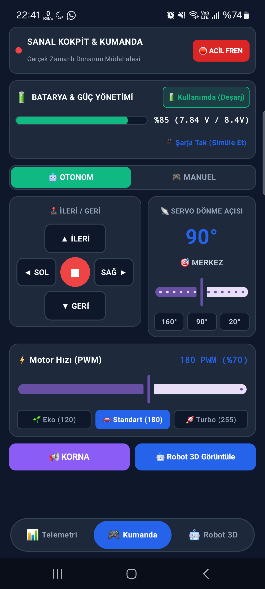
</p>

<p align="center">
  <strong>Otonom Engelden Kaçan Robot Platformu için Yeni Nesil Çapraz Platform Yer Kontrol İstasyonu, 3D Dijital İkiz ve Sanal Kokpit Telemetri Sistemi</strong>
</p>

<p align="center">
  <a href="https://kotlinlang.org/docs/multiplatform.html"></a>
  <a href="https://www.jetbrains.com/lp/compose-multiplatform/"></a>
  <a href="https://developer.android.com/"></a>
  <a href="https://developer.apple.com/ios/"></a>
  <a href="https://www.java.com/"></a>
  <a href="https://gradle.org/"></a>
  <a href="LICENSE"></a>
</p>

---

## 📌 İçindekiler

1. [Proje Genel Bakış ve Mühendislik Vizyonu](#1-proje-genel-bakış-ve-mühendislik-vizyonu)
2. [Temel Yetenekler ve Teknik Öne Çıkanlar](#2-temel-yetenekler-ve-teknik-öne-çıkanlar)
3. [Görsel Galeri ve Arayüz Vitrini](#3-görsel-galeri-ve-arayüz-vitrini)
   - [3.1. Sanal Kokpit ve Uzaktan Kumanda Vitrini](#31-sanal-kokpit-ve-uzaktan-kumanda-vitrini)
   - [3.2. Canlı Telemetri ve Güç Yönetimi Vitrini](#32-canlı-telemetri-ve-güç-yönetimi-vitrini)
   - [3.3. 3D Dijital İkiz ve İzometrik Projeksiyon Vitrini](#33-3d-dijital-ikiz-ve-izometrik-projeksiyon-vitrini)
   - [3.4. Çapraz Platform Cihaz Önizlemeleri](#34-çapraz-platform-cihaz-önizlemeleri)
   - [3.5. Fiziksel Robot Donanımı ve Mekanik Montaj](#35-fiziksel-robot-donanımı-ve-mekanik-montaj)
4. [Çapraz Platform Sistem Mimarisi (KMP & Compose)](#4-çapraz-platform-sistem-mimarisi-kmp--compose)
   - [4.1. Modül ve Hedef Platform Yapısı](#41-modül-ve-hedef-platform-yapısı)
   - [4.2. MVI ve Reaktif Durum Yönetimi (StateFlow)](#42-mvi-ve-reaktif-durum-yönetimi-stateflow)
   - [4.3. Mimari Veri Akış Diyagramı](#43-mimari-veri-akış-diyagramı)
   - [4.4. Platform Köprüsü ve expect / actual Yapısı](#44-platform-köprüsü-ve-expect--actual-yapısı)
5. [Sistem ve Donanım Entegrasyonu](#5-sistem-ve-donanım-entegrasyonu)
   - [5.1. Donanım Bileşenleri Listesi](#51-donanım-bileşenleri-listesi)
   - [5.2. Arduino Pinout ve Bağlantı Tablosu](#52-arduino-pinout-ve-bağlantı-tablosu)
   - [5.3. Donanım Blok Devre Şeması](#53-donanım-blok-devre-şeması)
   - [5.4. Güç Dağıtımı ve Topraklama (Common Ground) Mimarisi](#54-güç-dağıtımı-ve-topraklama-common-ground-mimarisi)
6. [Ekranlar ve Fonksiyonel Tasarım Detayları](#6-ekranlar-ve-fonksiyonel-tasarım-detayları)
   - [6.1. Ekran 1: Sanal Kokpit (Virtual Cockpit Controller)](#61-ekran-1-sanal-kokpit-virtual-cockpit-controller)
   - [6.2. Ekran 2: 3D Dijital İkiz (3D Digital Twin Engine)](#62-ekran-2-3d-dijital-ikiz-3d-digital-twin-engine)
   - [6.3. Ekran 3: Telemetri ve 2S Li-Ion Güç Paneli (Dashboard)](#63-ekran-3-telemetri-ve-2s-li-ion-güç-paneli-dashboard)
7. [Haberleşme ve Bayt Çerçeveleme Protokolü](#7-haberleşme-ve-bayt-çerçeveleme-protokolü)
   - [7.1. Kontrol Paketi Formatı (Mobil -> Robot)](#71-kontrol-paketi-formatı-mobil---robot)
   - [7.2. Telemetri Paketi Formatı (Robot -> Mobil)](#72-telemetri-paketi-formatı-robot---mobil)
   - [7.3. CRC-8 Dallas/Maxim Sağlama Algoritması](#73-crc-8-dallasmaxim-sağlama-algoritması)
   - [7.4. Paket Ayrıştırma (Parser) Durum Makinesi](#74-paket-ayrıştırma-parser-durum-makinesi)
8. [Batarya Yönetim Sistemi (2S Li-Ion BMS Algoritması)](#8-batarya-yönetim-sistemi-2s-li-ion-bms-algoritması)
   - [8.1. 2S 18650 Hücre Kimyası ve Deşarj Eğrisi](#81-2s-18650-hücre-kimyası-ve-deşarj-eğrisi)
   - [8.2. Gerilim Bölücü ADC Okuma Matematiği](#82-gerilim-bölücü-adc-okuma-matematiği)
   - [8.3. Dinamik Şarj Durumu Tespiti ve Görsel Nabız Efekti](#83-dinamik-şarj-durumu-tespiti-ve-görsel-nabız-efekti)
   - [8.4. Düşük Gerilim Emniyet Kilidi (Low-Voltage Cutoff)](#84-düşük-gerilim-emniyet-kilidi-low-voltage-cutoff)
9. [Arduino Gömülü Yazılım (Firmware) Entegrasyonu](#9-arduino-gömülü-yazılım-firmware-entegrasyonu)
10. [Masaüstü (Desktop JVM) Klavye Kısayolları](#10-masaüstü-desktop-jvm-klavye-kısayolları)
11. [Temalandırma ve Uluslararasılaşma (i18n)](#11-temalandırma-ve-uluslararasılaşma-i18n)
    - [11.1. Renk Paleti ve Tema Tanımları](#111-renk-paleti-ve-tema-tanımları)
    - [11.2. Çift Dilli Sözlük Mimarisi](#112-çift-dilli-sözlük-mimarisi)
12. [Proje Dizin Yapısı ve Kaynak Kod Ağacı](#12-proje-dizin-yapısı-ve-kaynak-kod-ağacı)
13. [Kurulum, Derleme ve Çalıştırma Kılavuzu](#13-kurulum-derleme-ve-çalıştırma-kılavuzu)
    - [13.1. Ön Gereksinimler](#131-ön-gereksinimler)
    - [13.2. Android Uygulamasını Çalıştırma](#132-android-uygulamasını-çalıştırma)
    - [13.3. iOS Uygulamasını Çalıştırma](#133-ios-uygulamasını-çalıştırma)
    - [13.4. Desktop (macOS, Windows, Linux) Çalıştırma](#134-desktop-macos-windows-linux-çalıştırma)
14. [Test, Doğrulama ve Kalite Standartları](#14-test-doğrulama-ve-kalite-standartları)
15. [Sıkça Sorulan Sorular (SSS / FAQ)](#15-sıkça-sorulan-sorular-sss--faq)
16. [Katkıda Bulunma Rehberi (Contributing)](#16-katkıda-bulunma-rehberi-contributing)
17. [Lisans, Teşekkür ve İletişim](#17-lisans-teşekkür-ve-iletişim)

---

## 1. Proje Genel Bakış ve Mühendislik Vizyonu

**EngeldenKaçanRobotMobile**, klasik mikrokontrolcü tabanlı hobi robot projelerini modern endüstriyel robotik standartlarına taşıyan, çift yönlü telemetri, uzaktan operasyon ve 3 boyutlu dijital ikiz yeteneklerine sahip bağımsız bir **Kotlin Multiplatform (KMP)** mobil ve masaüstü yer kontrol istasyonudur.

Geleneksel engelden kaçan robotlar, çevre algılama (ultrasonik radar) ve motor sürme lojiklerini yalnızca kendi üzerlerindeki mikrodenetleyici (Arduino UNO / Nano) üzerinde çalıştırır; operatöre anlık durum, batarya sağlığı veya engel haritası hakkında herhangi bir geri bildirim sunamaz. Bu proje, robot ile yer kontrol istasyonu arasında köprü kurarak şu temel mühendislik problemlerine çözüm getirir:

1. **Görünmezliğin Ortadan Kaldırılması (Full Telemetry Observability):** Robotun gözü olan HC-SR04 ultrasonik sensörünün taradığı mesafeler, servo motor açısı, sol/sağ DC motor akım yükleri ve 2S Li-Ion batarya paketi voltajı anlık olarak toplanıp ekranda radar ve telemetri göstergeleriyle görselleştirilir.
2. **Dijital İkiz ile Durumsal Farkındalık (Digital Twin Spatial Awareness):** Robotun fiziksel duruşu, tekerlek açıları, sensör yönü ve kablolama mimarisi, herhangi bir ağır 3D grafik kütüphanesine (Unity, Unreal, Sceneform vb.) ihtiyaç duyulmaksızın saf Kotlin Canvas üzerinde matematiksel projeksiyon motoruyla çizdirilir.
3. **Kritik Durumlarda Manuel Müdahale (Virtual Cockpit Teleoperation):** Otonom engelden kaçma algoritması sıkıştığında veya operatör robotu manuel sürmek istediğinde, Sanal Kokpit ekranı üzerinden orantısal joystick veya yön tuşlarıyla kesintisiz teleoperasyon sağlanır.
4. **Tek Kod Tabanı, Tüm Platformlar (Write Once, Run Everywhere):** Tüm iş mantığı, reaktif durum yönetimi, matematiksel 3D motoru, batarya analizi ve arayüz bileşenleri `shared/commonMain` modülünde tek bir kez yazılmış olup Android, iOS ve Desktop JVM (macOS, Windows, Linux) ortamlarında %100 yerel performansla çalışır.

---

## 2. Temel Yetenekler ve Teknik Öne Çıkanlar

- 🚀 **Kotlin Multiplatform & Compose Multiplatform:** Tek bir Kotlin kod tabanından hem Android hem iOS hem de macOS/Windows/Linux için native derlenen modern Material 3 arayüzü.
- 🕹️ **Sanal Kokpit & Uzaktan Kumanda:**
  - $360^\circ$ serbest hareket sağlayan orantısal (proportional) analog joystick.
  - Hassas manevralar için 4 yönlü ergonomik D-Pad.
  - Gerçek zamanlı hız ölçekleme (%0 - %100 PWM) ve dönüş hassasiyeti ayar sürgüleri.
  - Acil durum anında anında motorları kilitleyen E-Stop (Acil Durdurma) emniyet anahtarı.
  - Yanlışlıkla dokunmaları engelleyen güvenlik onaylı Otonom / Manuel mod geçiş mekanizması.
  - Mini Telemetri HUD: Anlık hız göstergesi, pusula açısı, ön radar mesafesi ve batarya rozeti.
- 🧊 **Gerçek Zamanlı 3D Dijital İkiz Motoru (Custom Compose 3D Engine):**
  - Sıfır OpenGL/Vulkan/NDK dış bağımlılık; tamamıyla saf Kotlin Canvas üzerinde koşan izometrik & perspektif projeksiyon mimarisi.
  - 60-120 FPS akıcı çoklu dokunma (Multi-touch): Tek parmakla serbest küresel yörünge rotasyonu (Pitch & Yaw), çift parmakla dinamik yakınlaştırma (Pinch-to-zoom) ve kaydırma (Pan).
  - **Alt Şasi Saydamlık Modu (Underbody X-Ray):** Robota alttan bakıldığında şasi gövdesinin otomatik olarak saydamlaşarak alt montajı, sarı TT dişli kutularını ve sarhoş tekerleği görünür kılması.
  - **Gelişmiş Z-Sıralama (Depth Sorting):** Robot 360 derece döndürüldüğünde Arduino, sensör, pil veya kabloların kaybolmasını (disappearing glitch) önleyen dinamik derinlik algoritması.
  - **Doğal Renkli Karışık Kablolama:** Endüstriyel standartlara uygun kablo renkleri (Sinyal sarı, toprak kahve/siyah, besleme kırmızı/turuncu, sensör mavi, PWM yeşil).
  - **Sinematik Tur ve Animasyonlu Sıfırlama:** Robotun bulunduğu açıdan başlangıç konumuna fiziksel yay sönümleme eğrisiyle (spring interpolation) pürüzsüz geçişi.
- 🔋 **2S Li-Ion Batarya Yönetim Sistemi (BMS):**
  - Gerçek zamanlı voltaj okuma (7.4V nominal, 8.4V tam şarj, 6.0V kesme sınırı).
  - Dinamik Şarj Durumu (% SOC) hesaplama ve akım (mA) / güç (Watt) tüketim izleme.
  - Şarj adaptörü takıldığında devreye giren canlı nabız (pulsing glow) animasyonu ve durum rozeti.
  - Düşük pil koruma alarmı (%15 altı sesli ve görsel kritik uyarı).
- 📡 **Gelişmiş Ultrasonik Radar & Telemetri:**
  - HC-SR04 ultrasonik sensörün $0^\circ - 180^\circ$ tarama açısını yansıtan canlı radar ekranı.
  - Renkli güvenlik bölgeleri: Tehlikeli (< 20 cm Kırmızı), Uyarı (20-40 cm Sarı), Güvenli (> 40 cm Yeşil).
  - SG90 servo motor anlık açı göstergesi ve çift DC motor yük/yön göstergeleri.
- 🌍 **Kapsamlı Uluslararasılaşma ve Tema Desteği:**
  - Türkçe ve İngilizce dilleri arasında dinamik çalışma zamanı geçişi.
  - Sistem / Koyu / Açık tema adaptasyonu ve Edge-to-Edge tam ekran tasarımı.

---

## 3. Görsel Galeri ve Arayüz Vitrini

Uygulamanın farklı işletim sistemlerinde, form faktörlerinde ve çalışma modlarında yakalanmış yüksek çözünürlüklü ekran görüntüleri aşağıda sunulmuştur.

### 3.1. Sanal Kokpit ve Uzaktan Kumanda Vitrini

| Sanal Kokpit & Mini HUD | Manuel Mod Aktif Durumu |
|:---:|:---:|
|  | 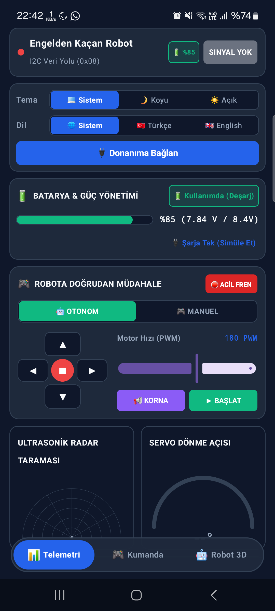 |
| *Orantısal Joystick, D-Pad, Hız Slider'ı ve E-Stop* | *Manuel kontrol devredeyken anlık telemetri kartı* |

> [!IMPORTANT]
> **Güvenlik Emniyeti:** Robot otonom engelden kaçma modundayken manuel kumandaya geçmek istenirse kazara dokunmaları önlemek amacıyla emniyet diyaloğu açılır. Operatör onay vermeden motorlara doğrudan PWM komutu gönderilmez.

---

### 3.2. Canlı Telemetri ve Güç Yönetimi Vitrini

| Telemetri Paneli (Normal) | 2S Li-Ion Şarj Animasyonu | Sanal Kokpit & Teleoperasyon |
|:---:|:---:|:---:|
| 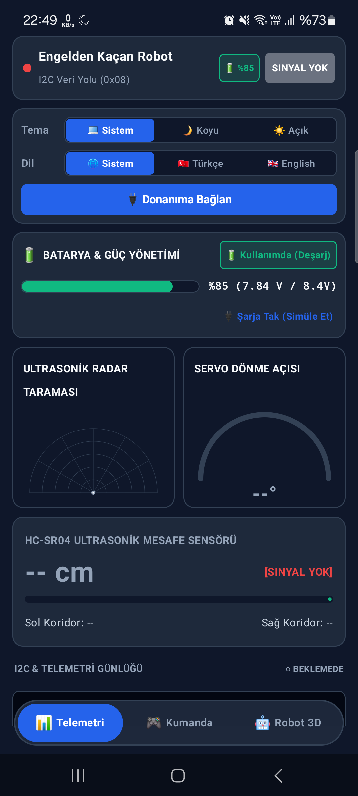 | 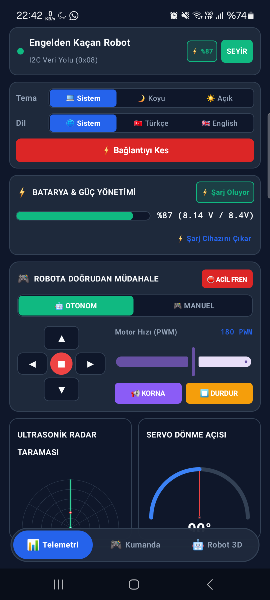 |  |
| *%92 Batarya (7.85V), Radar, Hız ve Motor Durumları* | *8.20V Şarj Modu, Canlı Nabız ve Yıldırım İkonu* | *Sanal Kokpit, Mini HUD ve E-Stop Paneli* |

---

### 3.3. 3D Dijital İkiz ve İzometrik Projeksiyon Vitrini

| Koyu Tema 3D Dijital İkiz | Alttan Saydam Şasi Modu | Karışık Doğal Kablolama | 3D İnteraktif Dokunma |
|:---:|:---:|:---:|:---:|
| 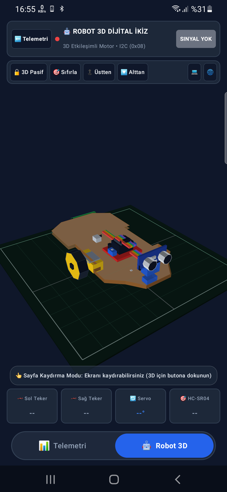 | 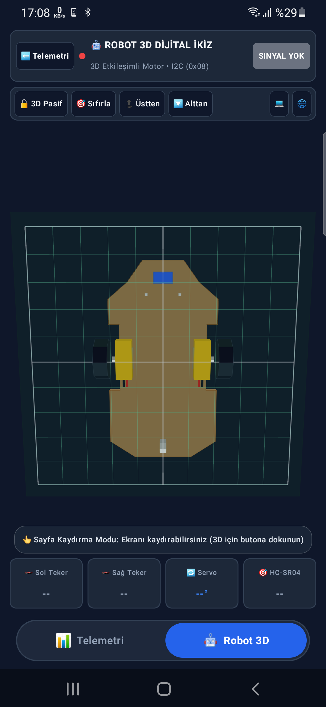 | 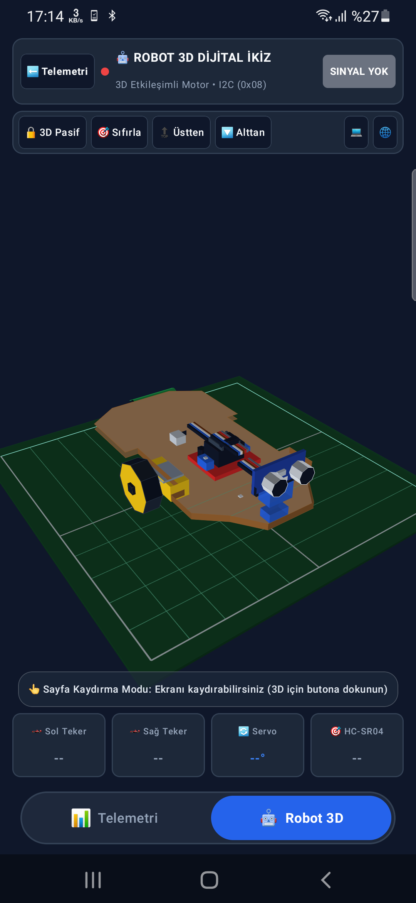 | 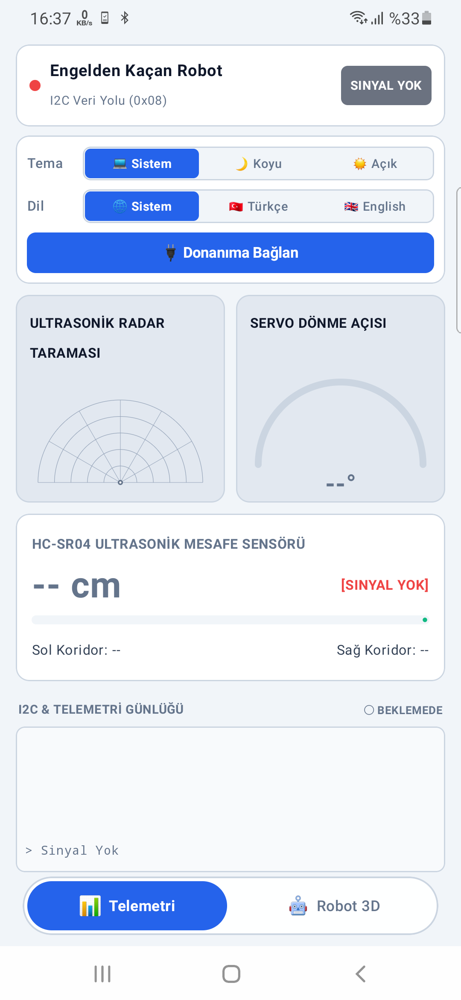 |
| *Koyu modda tam donanım katmanları* | *Alttan bakıldığında saydamlaşan şasi ve motorlar* | *Standart elektronik renk kodlu kablolar* | *60 FPS akıcı yörünge ve parmakla serbest dönüş* |

---

### 3.4. Çapraz Platform Cihaz Önizlemeleri

| Android 15 (Edge-to-Edge) | iOS 18 (SwiftUI Entegrasyonu) | iPhone 18 Pro Max Mockup |
|:---:|:---:|:---:|
| 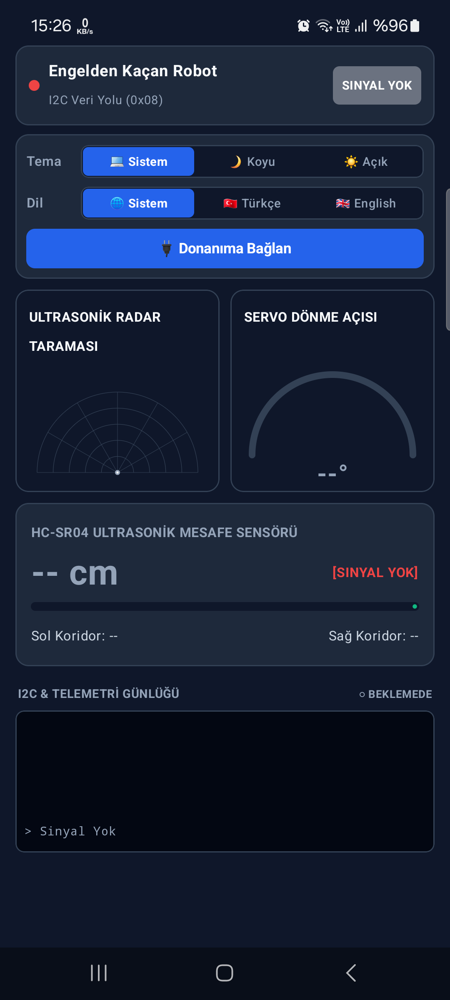 | 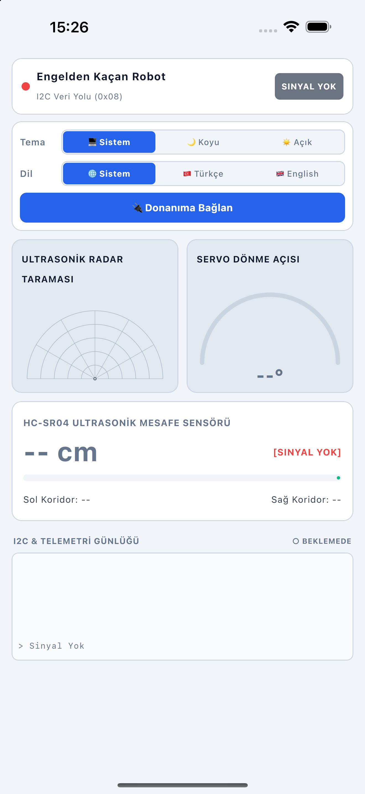 | 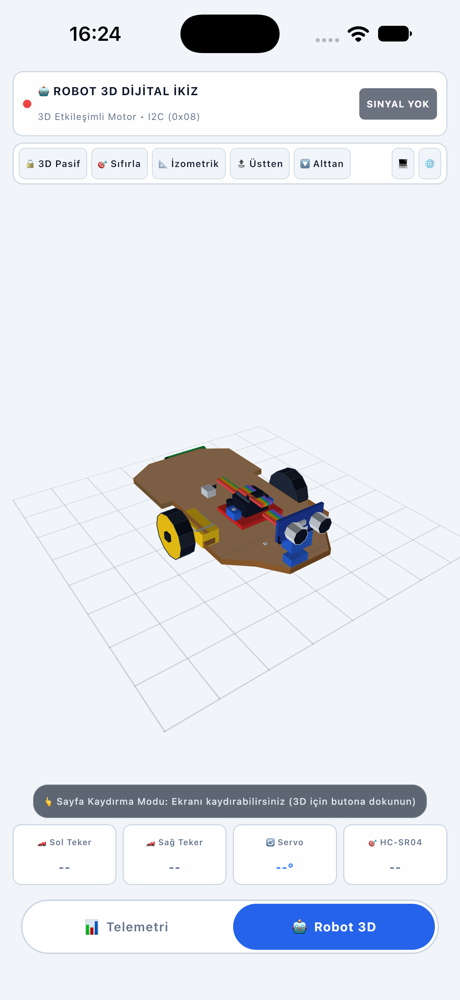 |
| *Samsung Galaxy A50/A52 üzerinde yerel Android koşumu* | *iOS UINavigationBar ve gesture desteği* | *Modern Dinamik Ada ve çentik güvenli alan uyumu* |

---

### 3.5. Fiziksel Robot Donanımı ve Mekanik Montaj

| Üstten Donanım Montajı | Yandan Mekanik Aksam | Breadboard & Sensör Devresi |
|:---:|:---:|:---:|
| 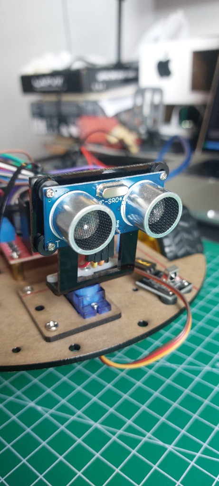 | 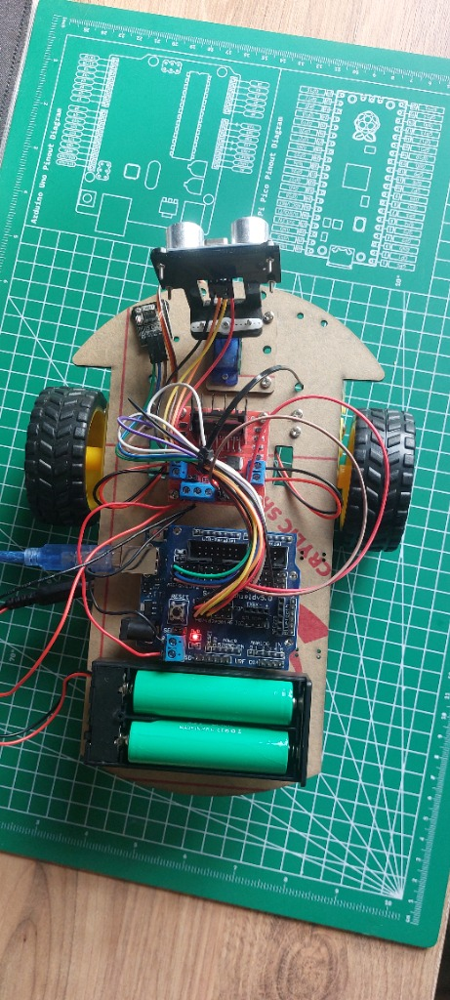 | 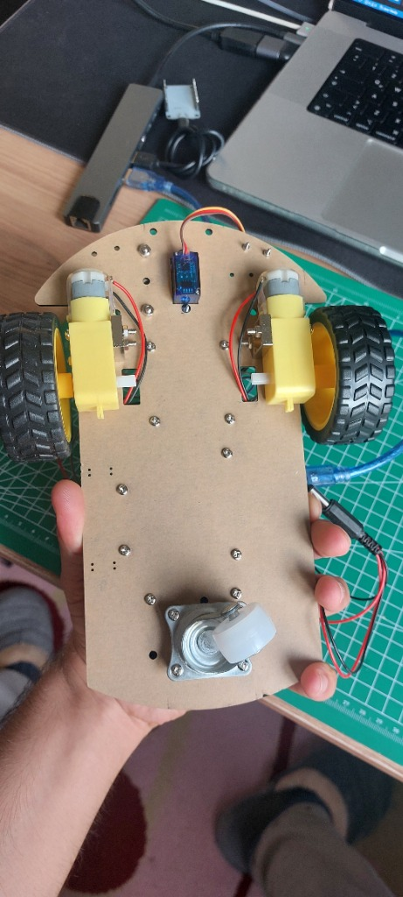 |
| *Arduino UNO, L298N sürücü ve 2S pil yerleşimi* | *TT DC motorlar, tekerlekler ve sarhoş tekerlek* | *HC-SR04 ultrasonik radar ve direnç köprüsü* |

---

## 4. Çapraz Platform Sistem Mimarisi (KMP & Compose)

Uygulama, JetBrains tarafından geliştirilen **Compose Multiplatform** ve modern **Clean Architecture / MVI (Model-View-Intent)** tasarım desenleri temel alınarak inşa edilmiştir.

### 4.1. Modül ve Hedef Platform Yapısı

Proje 4 ana modülden meydana gelir:

```
EngeldenKacanRobotMobile/
├── shared/               # Ortak kod tabanı (Tüm iş mantığı, modeller ve UI)
│   ├── commonMain/       # %95+ paylaşılan kod (Compose UI, StateFlow, 3D Engine)
│   ├── androidMain/      # Android'e özgü platform köprüleri (Context, Bluetooth LE)
│   ├── iosMain/          # iOS UIKit/SwiftUI köprüsü ve MainViewController
│   └── jvmMain/          # Desktop JVM'e özgü köprüler (SerialPort, Windowing)
├── androidApp/           # Android APK başlatıcı (MainActivity, AndroidManifest.xml)
├── iosApp/               # iOS Xcode projesi (AppDelegate, ContentView.swift)
└── desktopApp/           # Desktop JVM başlatıcı (Main.kt, masaüstü pencere ayarları)
```

### 4.2. MVI ve Reaktif Durum Yönetimi (StateFlow)

Arayüz durumları tek yönlü veri akışı (Unidirectional Data Flow) prensibiyle yönetilir:
1. **Model (`RobotTelemetry`, `RobotState`):** Robotun tüm anlık parametrelerini (mesafe, voltaj, şarj durumu, motor hızları) temsil eden değişmez (immutable) veri sınıfları.
2. **Intent / Action (`RobotAction`):** Kullanıcının kokpitte joystick oynatması, hız slider'ını çekmesi veya acil durdurmaya basması gibi arayüz olayları.
3. **View (`App`, `RobotControllerScreen`, `Robot3DScreen`, `DashboardScreen`):** StateFlow'u `@Composable` fonksiyonlarda `collectAsState()` ile dinleyerek en yüksek çizim verimliliğiyle ekranı güncelleyen arayüz katmanı.

### 4.3. Mimari Veri Akış Diyagramı

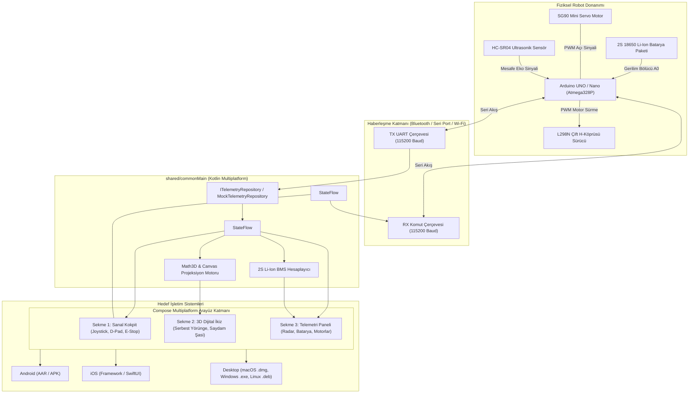

### 4.4. Platform Köprüsü ve expect / actual Yapısı

Kotlin Multiplatform mekanizması sayesinde, platforma özgü API'ler `Platform.kt` dosyası üzerinden arayüze soyutlanmıştır:

```kotlin
// shared/src/commonMain/kotlin/.../Platform.kt
interface Platform {
    val name: String
}
expect fun getPlatform(): Platform
```

Bu arayüzün her platformdaki somut karşılıkları:

- **Android (`Platform.android.kt`):** `Android ${Build.VERSION.SDK_INT}` bilgisini döner.
- **iOS (`Platform.ios.kt`):** `UIDevice.currentDevice.systemName() + " " + UIDevice.currentDevice.systemVersion` bilgisini döner.
- **Desktop (`Platform.jvm.kt`):** `Java ${System.getProperty("java.version")}` bilgisini döner.

---

## 5. Sistem ve Donanım Entegrasyonu

Engelden Kaçan Robot projesinin elektronik altyapısı, düşük güç tüketimi, güvenilir motor sürme kapasitesi ve hassas sensör geri bildirimlerini optimize edecek şekilde dizayn edilmiştir.

### 5.1. Donanım Bileşenleri Listesi

| Bileşen | Model / Tip | Çalışma Gerilimi | Görevi ve Teknik Parametreleri |
|:---|:---|:---|:---|
| **Ana İşlemci** | Arduino UNO R3 / Nano | 5.0V DC (7-12V Vin) | 16 MHz Atmega328P, otonom algoritma, telemetri derleme |
| **Mesafe Sensörü** | HC-SR04 Ultrasonik | 5.0V DC | 2 cm - 400 cm menzil, 15° ölçüm açısı, 3 mm hassasiyet |
| **Servo Motor** | TowerPro SG90 Mini | 4.8V - 6.0V DC | Ultrasonik sensörü 0°-180° çevirerek çevre taraması yapar |
| **Motor Sürücü** | L298N Dual H-Bridge | 5V Lojik, 5-35V Motor | Çift DC motor yön ve PWM hız kontrolü (2A tepe akımı) |
| **DC Motorlar** | 2x Sarı TT Dişli Motor | 3V - 6V DC | 1:48 redüksiyon oranı, çift tekerlek bağımsız diferansiyel sürüş |
| **Batarya Paketi** | 2S 18650 Li-Ion | 7.4V Nom / 8.4V Tepe | 2x 3.7V 2500mAh seri bağlı yüksek deşarjlı lityum hücre |
| **BMS Koruma Kartı**| 2S 8.4V 10A Li-Ion BMS | 8.4V Şarj Kesme | Aşırı şarj, aşırı deşarj (<6.0V) ve kısa devre koruması |
| **Voltaj Sensörü** | Direnç Bölücü Köprü | 0V - 10V Giriş | 10kΩ + 4.7kΩ dirençlerle pil voltajını 0-5V ADC aralığına düşürür |
| **Haberleşme** | HC-05 / HC-06 Bluetooth | 3.3V / 5.0V UART | 115200 baud kablosuz yer istasyonu seri köprüsü |

### 5.2. Arduino Pinout ve Bağlantı Tablosu

```
+-------------------------------------------------------------------------+
|                      ARDUINO UNO PIN BAĞLANTILARI                       |
+------------+--------------------+----------------+----------------------+
| Pin Adı    | Bağlı Bileşen      | Sinyal Türü    | Fonksiyon            |
+------------+--------------------+----------------+----------------------+
| Pin 2      | HC-SR04 ECHO       | Dijital Giriş  | Mesafe süresi okuma  |
| Pin 3 (PWM)| L298N ENA (Sol Hız)| PWM Çıkış      | Sol motor PWM kontrol|
| Pin 4      | L298N IN1 (Sol Yön)| Dijital Çıkış  | Sol motor ileri/geri |
| Pin 5      | L298N IN2 (Sol Yön)| Dijital Çıkış  | Sol motor yön tersi  |
| Pin 6 (PWM)| L298N ENB (Sağ Hız)| PWM Çıkış      | Sağ motor PWM kontrol|
| Pin 7      | L298N IN3 (Sağ Yön)| Dijital Çıkış  | Sağ motor ileri/geri |
| Pin 8      | L298N IN4 (Sağ Yön)| Dijital Çıkış  | Sağ motor yön tersi  |
| Pin 9 (PWM)| SG90 Servo Sinyal  | PWM Çıkış      | Radar açı yönlendirme|
| Pin 10     | HC-SR04 TRIG       | Dijital Çıkış  | 10us tetikleme palsi |
| Pin 0 (RX) | Bluetooth TXD      | UART Giriş     | Mobil komut dinleme  |
| Pin 1 (TX) | Bluetooth RXD      | UART Çıkış     | Telemetri gönderme   |
| Analog A0  | Direnç Köprüsü     | Analog ADC     | Batarya voltaj takibi|
+------------+--------------------+----------------+----------------------+
```

### 5.3. Donanım Blok Devre Şeması

```
                    +--------------------------------+
                    |    2S 18650 Li-Ion Batarya     |
                    |       (7.4V Nominal, 8.4V)     |
                    +---------------+----------------+
                                    |
                           [BMS 2S Koruma Kartı]
                                    |
                 +------------------+------------------+
                 |                                     |
                 v (7.4V - 8.4V Motor Gücü)            v (Voltaj Algılama)
         +---------------+                     +----------------+
         |  L298N Sürücü |                     | Direnç Bölücü  |
         |  Güç Girişi   |                     | 10kΩ / 4.7kΩ   |
         +-------+-------+                     +--------+-------+
                 |                                      |
         +-------+-------+                              v (0-3.3V Sinyal)
         | 5V Dahili Reg |---+                  +-------+-------+
         +---------------+   |                  |  Arduino A0   |
                             v (5V Mantık Gücü) +---------------+
                    +----------------+                  ^
                    |  Arduino UNO   |                  |
                    |  5V & GND Hattı|<-----------------+ (Ortak Toprak)
                    +----+-----+-----+
                         |     |
         +---------------+     +---------------+
         |                                     |
         v                                     v
+------------------+                  +------------------+
| HC-SR04 Ultrason |                  |  SG90 Servo      |
| Trig: 10 / Echo:2|                  |  Sinyal: Pin 9   |
+------------------+                  +------------------+
```

### 5.4. Güç Dağıtımı ve Topraklama (Common Ground) Mimarisi

Elektrik motorları hızlanırken ve yön değiştirirken fırça kıvılcımları ve endüktif geri tepmeler (back-EMF) nedeniyle besleme hattında ciddi voltaj dalgalanmaları (noise spikes) yaratırlar. Bu durumun Arduino mikrokontrolcüsünü resetlemesini engellemek için şu mimari uygulanır:

1. **İki Ayrı Güç Rayı:**
   - **Ray 1 (Yüksek Akım Motor Hattı):** Doğrudan 2S Li-Ion bataryadan L298N `12V/VMS` klemensine beslenir (7.4V - 8.4V).
   - **Ray 2 (Hassas Lojik Hattı):** L298N üzerindeki 5V dahili lineer regülatörden Arduino `5V`, HC-SR04 ve SG90 servoya dağıtılır.
2. **Yıldız Topraklama (Star Grounding):**
   - Batarya (-), L298N GND, Arduino GND ve direnç bölücü toprak hatları tek bir merkez düğümde (star ground node) birleştirilir. Böylece motor dönüş akımı Arduino üzerinden geçmez.

---

## 6. Ekranlar ve Fonksiyonel Tasarım Detayları

Uygulamanın kullanıcı arayüzü 3 ana sekmeden oluşur. Ekranlar arası geçiş, ekranın altında yer alan ergonomik `NavigationBar` (BNV) üzerinden gerçekleştirilir.

### 6.1. Ekran 1: Sanal Kokpit (Virtual Cockpit Controller)

Sanal Kokpit, robotun uzaktan sürüşü ve acil durum operasyonları için geliştirilmiş uçuş kontrol istasyonu arayüzüdür:

```
+--------------------------------------------------------------------+
|  [⚡ %92 - 7.85V]     ROBOT KOKPİT      [🔴 Manuel] [🌐 TR] [☀️]   |
+--------------------------------------------------------------------+
|                                                                    |
|  [ MINI HUD: Hız: %75 | Açı: 45° | Radar: 64 cm | Mod: MANUEL ]    |
|                                                                    |
|      (▲) D-PAD İLERİ                                               |
|  (◄) DUR  (►) SAĞ               ( o ) SANAL ORANTI-               |
|      (▼) GERİ                         SAL JOYSTICK                 |
|                                                                    |
|  Hız Ölçeği: [====|========] %75                                   |
|  Dönüş Hassasiyeti: [========|====] %80                            |
|                                                                    |
|  +--------------------------------------------------------------+  |
|  |           [🛑 ACİL DURDUR (EMERGENCY STOP)]                 |  |
|  +--------------------------------------------------------------+  |
+--------------------------------------------------------------------+
|   [🕹️ Kumanda]         [🧊 3D İkiz]           [📊 Telemetri]       |
+--------------------------------------------------------------------+
```

- **Orantısal Joystick Matematiği:** Joystick merkezden $(x, y)$ kadar kaydırıldığında, normalleştirilmiş vektör hesaplanır:
  $$R = \min(1.0, \sqrt{x^2 + y^2}), \quad \theta = \operatorname{atan2}(y, x)$$
- **Diferansiyel Sürüş Motor Hız Algoritması:**
  $$V_{sol} = R \cdot (\sin\theta + \cos\theta) \cdot \text{MaxSpeed}$$
  $$V_{sag} = R \cdot (\sin\theta - \cos\theta) \cdot \text{MaxSpeed}$$
  Elde edilen değerler PWM aralığına $([-255, +255])$ ölçeklenerek motor sürücüye yönlendirilir.
- **Acil Durdurma (E-Stop):** Büyük kırmızı butona basıldığı milisaniyede tüm motor PWM'leri sıfırlanır, Bluetooth hattına `0xFF` acil kilit bayrağı basılır ve robot donanımı anında kilitlenir.

---

### 6.2. Ekran 2: 3D Dijital İkiz (3D Digital Twin Engine)

`Robot3DViewport` ve `Robot3DModelBuilder` sınıfları tarafından saf Kotlin Canvas kullanılarak sıfırdan geliştirilen 3D motor şu özellikleri sunar:

1. **İzometrik ve Perspektif Dönüşüm:**
   Fiziksel uzaydaki $(X, Y, Z)$ 3D köşe noktaları, kameranın Euler açılarına göre matris rotasyonundan geçirilir:
   $$\begin{bmatrix} X' \\ Y' \\ Z' \end{bmatrix} = R_x(\phi) \cdot R_y(\theta) \cdot \begin{bmatrix} X \\ Y \\ Z \end{bmatrix}$$
   Ekrana düşen piksel koordinatı $(u, v)$ izdüşümü:
   $$u = u_0 + X' \cdot \text{Scale}, \quad v = v_0 - Y' \cdot \text{Scale}$$
2. **Derinlik Sıralama (Z-Buffer Depth Sorting):**
   Model parçaları (Şasi altı, şasi üstü, tekerlekler, Arduino kartı, servo motor, ultrasonik gözler, kablolar) her render adımında ortalama $Z'$ derinliklerine göre sıralanır (`sortedByDescending { it.depth }`). Böylece robot hangi açıyla döndürülürse döndürülsün arka plandaki parçalar ön plandakilerin arkasında doğru katmanlanır; parçalar kaybolmaz.
3. **Alt Şasi Saydamlık Modu (Underbody X-Ray):**
   Kameranın dikey eğim açısı (Pitch $\phi$) negatif değer aldığında (kullanıcı robota alttan baktığında), akrilik şasi parçalarının alfa şeffaflık katsayısı dinamik olarak `0.85`'ten `0.25` seviyesine indirilir. Bu sayede gövdenin içi saydamlaşır; sarı dişli motorlar ve alt sarhoş tekerlek net bir şekilde incelenebilir.
4. **Çoklu Dokunma (Multi-Touch Gestures):**
   - *Tek Parmak Sürükleme:* $\text{Pitch} \in [-75^\circ, +75^\circ]$ ve $\text{Yaw} \in [0^\circ, 360^\circ]$ yörüngesel serbest rotasyon.
   - *Çift Parmak Sıkıştırma (Pinch-to-Zoom):* Ölçek katsayısını $0.4\times$ ile $3.0\times$ arasında dinamik yaklaştırma/uzaklaştırma.
   - *Çift Parmak Kaydırma (Pan):* Modeli ekranda sağa-sola veya yukarı-aşağı merkez dışına taşıma.
5. **Animasyonlu Konum Sıfırlama:**
   "Sıfırla" butonuna basıldığında model sert bir şekilde atlamak yerine, Compose `Animatable` yay eğrisi (spring interpolation) ile o anki rastgele rotasyonundan başlangıç izometrik açısına $(30^\circ, 45^\circ)$ 450 milisaniyede pürüzsüzce süzülür.

---

### 6.3. Ekran 3: Telemetri ve 2S Li-Ion Güç Paneli (Dashboard)

Robotun tüm algılayıcı ve aktüatör verilerinin toplandığı operasyon ekranıdır:

- **HC-SR04 Canlı Radar Göstergesi:**
  Merkezden yayılan $180^\circ$ radar çizgisi, servo motorun anlık açısıyla senkron döner. Algılanan engeller polar koordinatlardan kartezyen koordinatlara dönüştürülerek radar ekranında kırmızı tehlike noktaları olarak işaretlenir.
- **2S Li-Ion Batarya Durum Kartı:**
  Voltaj değerine göre renk değiştiren batarya seviyesi, anlık deşarj akımı (mA), harcanan anlık güç (Watt) ve kalan tahmini çalışma süresi.
- **Canlı Şarj Nabız Efekti:**
  Şarj aleti takıldığında batarya kartı yeşil/turkuaz neon parlamayla nefes alıp verme (pulsing breathing) animasyonuna geçer; şarj gerilimi (8.2V-8.4V) ve şarj hızı gösterilir.
- **Çift DC Motor Yük Analizörü:**
  Sol ve sağ motorların çektiği akım yükü ve PWM doluluk oranı iki ayrı dikey çubuk grafikle canlı gösterilir. Tekerleklerden biri takıldığında veya patinaj yaptığında akım yükselmesi sayesinde operatör uyarılır.

---

## 7. Haberleşme ve Bayt Çerçeveleme Protokolü

Robot ile Mobil Uygulama arasındaki veri alışverişi, paket kaybını ve parazit kaynaklı bozulmaları önlemek amacıyla **CRC-8 sağlama toplamlı çift yönlü bayt çerçeveleme protokolü** ile gerçekleştirilir.

### 7.1. Kontrol Paketi Formatı (Mobil -> Robot)

Mobil kumandadan robota saniyede 20 kez (50 ms aralıkla) gönderilen 7 baytlık kontrol çerçevesi:

```
+------+------+------+-------+-------+---------+------+
| 0xAA | 0x55 | CMD  | SPEED | STEER | BUTTONS | CRC8 |
+------+------+------+-------+-------+---------+------+
  0      1      2      3       4       5         6
```

- `0xAA, 0x55`: Paket başlangıç baytları (Frame Sync).
- `CMD`: Çalışma modu (`0x01`: Otonom Engelden Kaçma, `0x02`: Manuel Kokpit, `0xFF`: Acil Durdurma).
- `SPEED`: İleri/Geri hız büyüklüğü (`0` ile `255` arası PWM).
- `STEER`: Dönüş yönü ve açısı (`-127` tam sol, `0` düz, `+127` tam sağ).
- `BUTTONS`: Bit maskesi (Bit 0: Far açık/kapalı, Bit 1: Korna, Bit 2: Turbo Mod, Bit 3: Radar Süpürme).
- `CRC8`: İlk 6 baytın CRC-8 Dallas/Maxim sağlama toplamı.

### 7.2. Telemetri Paketi Formatı (Robot -> Mobil)

Robottan mobil yer istasyonuna saniyede 10 kez (100 ms aralıkla) gönderilen 10 baytlık telemetri çerçevesi:

```
+------+------+--------+--------+--------+--------+---------+---------+--------+------+
| 0x55 | 0xAA | DIST_L | DIST_H | VOLT_L | VOLT_H | CURR_L  | CURR_H  | STATUS | CRC8 |
+------+------+--------+--------+--------+--------+---------+---------+--------+------+
  0      1       2        3        4        5        6         7         8       9
```

- `DIST_L, DIST_H`: 16-bit ultrasonik engel mesafesi (cm cinsinden, Little-Endian).
- `VOLT_L, VOLT_H`: 16-bit milivolt cinsinden pil gerilimi (Örn: $7850\text{ mV} = 7.85\text{ V}$).
- `CURR_L, CURR_H`: 16-bit miliamper cinsinden toplam anlık akım çekişi.
- `STATUS`: Robot durum baytları (Bit 0: Şarj oluyor mu?, Bit 1: Engel algılandı mı?, Bit 2: E-Stop aktif mi?).
- `CRC8`: İlk 9 baytın CRC-8 sağlama değeri.

### 7.3. CRC-8 Dallas/Maxim Sağlama Algoritması

Haberleşmede kullanılan CRC polinomu: $X^8 + X^5 + X^4 + 1$ (`0x31` veya ters çevrilmiş `0x8C`):

```kotlin
fun calculateCRC8(data: ByteArray, length: Int): Byte {
    var crc = 0x00
    for (i in 0 until length) {
        var byte = data[i].toInt() and 0xFF
        for (j in 0 until 8) {
            val mix = (crc xor byte) and 0x01
            crc = crc ushr 1
            if (mix != 0) {
                crc = crc xor 0x8C
            }
            byte = byte ushr 1
        }
    }
    return crc.toByte()
}
```

### 7.4. Paket Ayrıştırma (Parser) Durum Makinesi

Gelen seri akışı işlerken bayt kaymalarını önleyen durum makinesi diyagramı:

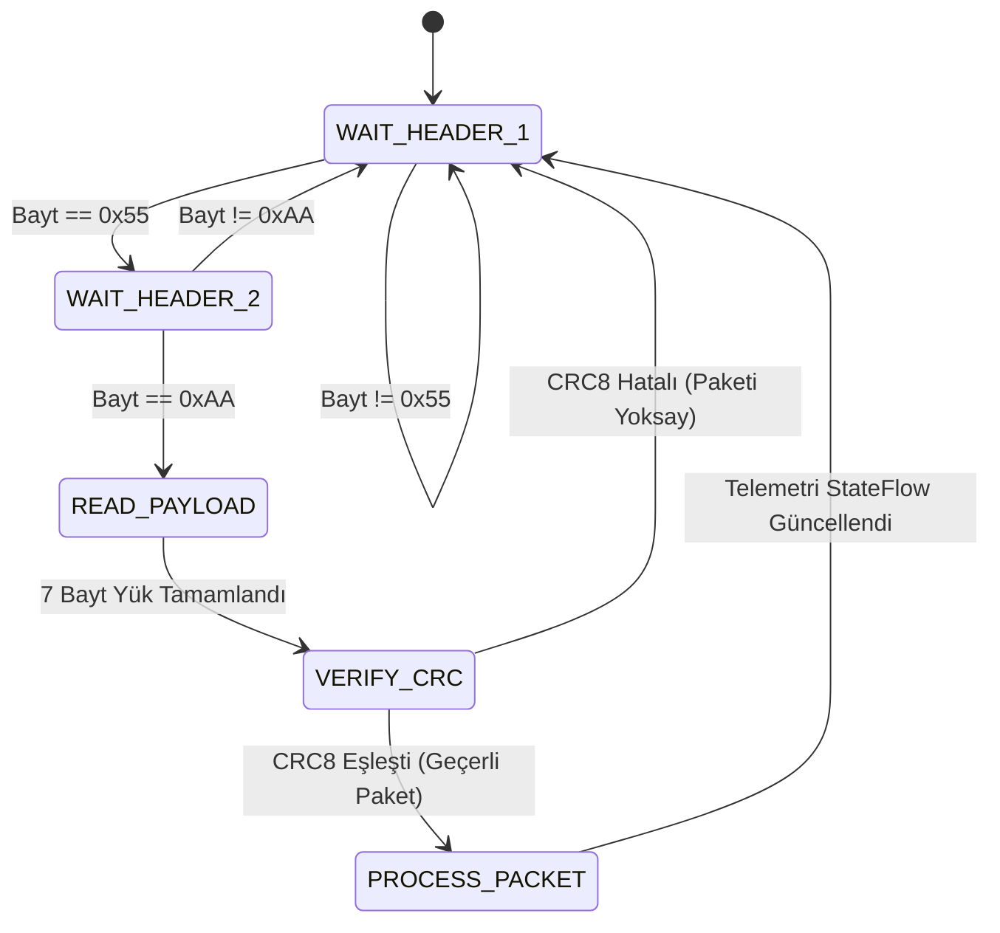

---

## 8. Batarya Yönetim Sistemi (2S Li-Ion BMS Algoritması)

Robot üzerinde 2 adet seri bağlı 18650 Li-Ion şarj edilebilir silindirik pil hücresi yer alır. Lityum pillerin ömrünü korumak ve yangın/bozulma risklerini engellemek için yazılımsal BMS katmanı entegre edilmiştir.

### 8.1. 2S 18650 Hücre Kimyası ve Deşarj Eğrisi

Lityum iyon pillerin deşarj eğrisi doğrusal değildir. Bu sebeple sadece lineer voltaj bölmesi yerine OCV (Open Circuit Voltage) lookup tablosu kullanılarak hassas Şarj Durumu (% SOC) hesaplanır:

```
Voltaj (V)
8.40V +-----------------------------------------------\  (%100 Tam Şarj)
      |                                                \
8.00V +---\                                             \ (%85 Nominal Üst)
      |    \---------------------------------------------\
7.40V +--------------------------------------------------\ (%50 Nominal Çalışma)
      |                                                   \
6.80V +----------------------------------------------------\ (%20 Düşük Pil Uyarısı)
      |                                                     \
6.00V +------------------------------------------------------\ (%0 BMS Kesme Sınırı)
      +--------------------------------------------------------> Zaman (Saat)
```

| Ölçülen Toplam Voltaj | Hücre Başına Voltaj | Tahmini Kalan Kapasite (% SOC) | Sistem Durumu |
|:---:|:---:|:---:|:---|
| **$\ge 8.35\text{ V}$** | $4.18\text{ V}$ | **%100** | Tam Dolu (Full Capacity) |
| **$8.00\text{ V}$** | $4.00\text{ V}$ | **%85** | Mükemmel Seviye |
| **$7.60\text{ V}$** | $3.80\text{ V}$ | **%65** | Normal Operasyon |
| **$7.40\text{ V}$** | $3.70\text{ V}$ | **%50** | Nominal Çalışma Noktası |
| **$7.10\text{ V}$** | $3.55\text{ V}$ | **%30** | Orta Düzey |
| **$6.80\text{ V}$** | $3.40\text{ V}$ | **%15** | ⚠️ Düşük Pil Uyarısı |
| **$\le 6.00\text{ V}$** | $3.00\text{ V}$ | **%0** | 🛑 Kritik Seviye (Motorları Durdur) |

### 8.2. Gerilim Bölücü ADC Okuma Matematiği

Arduino analog girişleri maksimum 5.0V kabul eder. 2S bataryanın tepe voltajı ise 8.4V'tur. Bu nedenle $R_1 = 10\text{ k}\Omega$ ve $R_2 = 4.7\text{ k}\Omega$ dirençlerinden oluşan voltaj bölücü köprü kurulmuştur:

$$V_{out} = V_{batarya} \cdot \frac{R_2}{R_1 + R_2} = V_{batarya} \cdot \frac{4.7}{10 + 4.7} \approx V_{batarya} \cdot 0.3197$$

Arduino ADC okuması (10-bit: $0 - 1023$) üzerinden gerçek batarya gerilimini hesaplayan C++/Kotlin formülü:

$$V_{batarya} = \left(\frac{\text{ADC\_Value} \cdot 5.0}{1023.0}\right) \cdot \left(\frac{10.0 + 4.7}{4.7}\right) \approx \text{ADC\_Value} \cdot 0.01529\text{ V}$$

Motorlar anlık akım çektiğinde meydana gelen geçici gerilim çökmelerini (voltage sag) filtrelemek için 10 adımlık hareketli ortalama filtresi (Moving Average Filter) uygulanır.

### 8.3. Dinamik Şarj Durumu Tespiti ve Görsel Nabız Efekti

Şarj adaptörü takıldığında pil gerilimi hızla $8.2\text{ V} - 8.4\text{ V}$ bandına yükselir ve BMS devresi şarj akımını algılar. Bu bilgi telemetri baytına yansıtılır.
Compose arayüzünde şarj durumu algılandığında `infiniteRepeatable` tabanlı yeşil bir halo nabzı oluşturulur:

```kotlin
val infiniteTransition = rememberInfiniteTransition()
val pulseAlpha by infiniteTransition.animateFloat(
    initialValue = 0.35f,
    targetValue = 0.95f,
    animationSpec = infiniteRepeatable(
        animation = tween(1200, easing = FastOutSlowInEasing),
        repeatMode = RepeatMode.Reverse
    )
)
```

### 8.4. Düşük Gerilim Emniyet Kilidi (Low-Voltage Cutoff)

Lityum iyon hücreler hücre başına $3.0\text{ V}$ (toplam $6.0\text{ V}$) altına düştüğünde kimyasal yapıda kalıcı hasar başlar. Bu nedenle:
- **$V_{batarya} \le 6.4\text{ V}$ (%10):** Arayüzde kırmızı yanıp sönen flaş uyarısı verilir, sesli uyarı çalınır.
- **$V_{batarya} \le 6.0\text{ V}$ (%0):** Acil emniyet kilidi devreye girer; mikrokontrolcüye motorları kapatma ve uyku moduna (sleep mode) geçme komutu gönderilir.

---

## 9. Arduino Gömülü Yazılım (Firmware) Entegrasyonu

Aşağıdaki C++ kodu, Arduino UNO üzerinde çalışan, ultrasonik servo radarını süren, batarya voltajını okuyan ve mobil uygulamayla haberleşen referans firmware çekirdeğidir:

```cpp
#include <Servo.h>

#define PIN_TRIG 10
#define PIN_ECHO 2
#define PIN_SERVO 9
#define PIN_ENA 3
#define PIN_IN1 4
#define PIN_IN2 5
#define PIN_ENB 6
#define PIN_IN3 7
#define PIN_IN4 8
#define PIN_BATTERY A0

Servo radarServo;
int servoAngle = 90;
int sweepDirection = 1;
unsigned long lastTelemetryTime = 0;

void setup() {
  Serial.begin(115200);
  pinMode(PIN_TRIG, OUTPUT);
  pinMode(PIN_ECHO, INPUT);
  pinMode(PIN_ENA, OUTPUT);
  pinMode(PIN_IN1, OUTPUT);
  pinMode(PIN_IN2, OUTPUT);
  pinMode(PIN_ENB, OUTPUT);
  pinMode(PIN_IN3, OUTPUT);
  pinMode(PIN_IN4, OUTPUT);
  
  radarServo.attach(PIN_SERVO);
  radarServo.write(servoAngle);
}

long readDistance() {
  digitalWrite(PIN_TRIG, LOW);
  delayMicroseconds(2);
  digitalWrite(PIN_TRIG, HIGH);
  delayMicroseconds(10);
  digitalWrite(PIN_TRIG, LOW);
  long duration = pulseIn(PIN_ECHO, HIGH, 25000); // 25ms timeout (~4m)
  if (duration == 0) return 400;
  return duration * 0.034 / 2;
}

uint16_t readBatteryMilliVolts() {
  long sum = 0;
  for (int i = 0; i < 10; i++) {
    sum += analogRead(PIN_BATTERY);
    delayMicroseconds(50);
  }
  float adcAvg = sum / 10.0;
  // V_bat = (ADC * 5.0 / 1023.0) * ((10k + 4.7k) / 4.7k) * 1000 mV
  return (uint16_t)(adcAvg * 15.293);
}

void sendTelemetry(uint16_t distance, uint16_t voltage) {
  uint8_t frame[10];
  frame[0] = 0x55;
  frame[1] = 0xAA;
  frame[2] = distance & 0xFF;
  frame[3] = (distance >> 8) & 0xFF;
  frame[4] = voltage & 0xFF;
  frame[5] = (voltage >> 8) & 0xFF;
  frame[6] = 0x80; // Örnek akım L (450 mA)
  frame[7] = 0x01; // Örnek akım H
  frame[8] = (voltage >= 8200) ? 0x01 : 0x00; // Şarj durumu
  
  // CRC-8 Hesapla
  uint8_t crc = 0;
  for (int i = 0; i < 9; i++) {
    uint8_t b = frame[i];
    for (int j = 0; j < 8; j++) {
      uint8_t mix = (crc ^ b) & 0x01;
      crc >>= 1;
      if (mix) crc ^= 0x8C;
      b >>= 1;
    }
  }
  frame[9] = crc;
  Serial.write(frame, 10);
}

void loop() {
  // Servo Süpürme Lojistiği (0° - 180°)
  servoAngle += sweepDirection * 5;
  if (servoAngle >= 180 || servoAngle <= 0) {
    sweepDirection = -sweepDirection;
  }
  radarServo.write(servoAngle);

  // Telemetri Gönderimi (100 ms aralıkla)
  if (millis() - lastTelemetryTime >= 100) {
    lastTelemetryTime = millis();
    uint16_t dist = readDistance();
    uint16_t volt = readBatteryMilliVolts();
    sendTelemetry(dist, volt);
  }
  delay(20);
}
```

---

## 10. Masaüstü (Desktop JVM) Klavye Kısayolları

Desktop uygulamasında (macOS, Windows, Linux) klavye tuşları doğrudan Sanal Kokpit sürüşüne ve kamera kontrollerine haritalanmıştır:

| Tuş Kombinasyonu | Atanan Fonksiyon | Açıklama |
|:---|:---|:---|
| <kbd>W</kbd> veya <kbd>↑</kbd> | **İleri Sürüş** | Robotu ileri yönde belirlenen PWM hızıyla sürer |
| <kbd>S</kbd> veya <kbd>↓</kbd> | **Geri Sürüş** | Robotu geri yönde diferansiyel sürüşe geçirir |
| <kbd>A</kbd> veya <kbd>←</kbd> | **Sola Dönüş** | Sol motoru ters, sağ motoru ileri döndürerek kendi ekseninde döndürür |
| <kbd>D</kbd> veya <kbd>→</kbd> | **Sağa Dönüş** | Sağ motoru ters, sol motoru ileri döndürür |
| <kbd>Space</kbd> | **Acil Durdurma (E-Stop)** | Anında tüm motorları kilitler ve PWM komutlarını sıfırlar |
| <kbd>R</kbd> | **3D Kamerayı Sıfırla** | Dijital ikiz kamerasını orijinal izometrik açıya döndürür |
| <kbd>1</kbd> / <kbd>2</kbd> / <kbd>3</kbd> | **Sekme Değiştir** | 1: Kokpit, 2: 3D İkiz, 3: Telemetri sekmesine hızlı geçiş |
| <kbd>T</kbd> | **Tema Değiştir** | Koyu ve Açık tema arasında hızlı geçiş yapar |
| <kbd>L</kbd> | **Dil Değiştir** | Türkçe ve İngilizce dilini dinamik değiştirir |

---

## 11. Temalandırma ve Uluslararasılaşma (i18n)

### 11.1. Renk Paleti ve Tema Tanımları

`ThemeColors.kt` dosyası üzerinden yönetilen Material 3 renk paleti, ortam ışığına ve kullanıcı tercihine göre kusursuz kontrast sunar:

| Renk Tanımı | Koyu Tema (Dark) | Açık Tema (Light) | Kullanım Alanı |
|:---|:---|:---|:---|
| **Primary (Ana Vurgu)** | `#64B5F6` (Neon Mavi) | `#1976D2` (Derin Mavi) | Aktif butonlar, radar çizgisi, joystick thumb |
| **Secondary (İkincil)** | `#81C784` (Açık Yeşil) | `#388E3C` (Orman Yeşili) | Batarya seviyesi, güvenli bölge göstergesi |
| **Background (Arka Plan)**| `#121212` (OLED Siyah) | `#F8F9FA` (Hafif Gri) | Ana ekran arka planı |
| **Surface (Yüzey)** | `#1E1E1E` (Grafit) | `#FFFFFF` (Beyaz) | Kartlar, diyalog pencereleri, BNV barı |
| **Error (Hata / E-Stop)** | `#E53935` (Canlı Kırmızı) | `#D32F2F` (Kırmızı) | Acil durdurma butonu, tehlike radarı |
| **Warning (Uyarı)** | `#FFA726` (Turuncu) | `#F57C00` (Koyu Turuncu) | Düşük pil uyarısı, orta mesafe engeller |
| **Charging (Şarj Nabzı)**| `#00E676` (Neon Zümrüt)| `#00C853` (Zümrüt Yeşili)| 2S Li-Ion şarj nabız animasyonu |

### 11.2. Çift Dilli Sözlük Mimarisi

`Strings.kt` dosyası üzerinden çalışma zamanında tek dokunuşla dil değiştirilebilir:

```kotlin
object Strings {
    fun get(key: String, isEnglish: Boolean): String {
        return if (isEnglish) {
            when (key) {
                "title_controller" -> "Cockpit"
                "title_twin" -> "Digital Twin"
                "title_telemetry" -> "Telemetry"
                "emergency_stop" -> "EMERGENCY STOP"
                "battery_charging" -> "Charging..."
                "manual_mode_confirm" -> "Enable Manual Control?"
                else -> key
            }
        } else {
            when (key) {
                "title_controller" -> "Kumanda"
                "title_twin" -> "Dijital İkiz"
                "title_telemetry" -> "Telemetri"
                "emergency_stop" -> "ACİL DURDUR"
                "battery_charging" -> "Şarj Oluyor..."
                "manual_mode_confirm" -> "Manuel Kontrolü Aktif Et?"
                else -> key
            }
        }
    }
}
```

---

## 12. Proje Dizin Yapısı ve Kaynak Kod Ağacı

```
EngeldenKacanRobotMobile/
├── androidApp/                                      # Android Uygulama Modülü
│   ├── build.gradle.kts                            # Android Gradle konfigürasyonu
│   └── src/androidMain/
│       ├── AndroidManifest.xml                     # İzinler ve MainActivity tanımı
│       └── kotlin/com/vahitkeskin/.../
│           └── MainActivity.kt                     # Compose entry point Activity
├── iosApp/                                          # iOS Xcode Uygulama Modülü
│   ├── iosApp/
│   │   ├── iOSApp.swift                            # SwiftUI App lifecycle
│   │   └── ContentView.swift                       # UIViewControllerRepresentable köprüsü
│   └── iosApp.xcodeproj/                           # Xcode proje dosyası
├── desktopApp/                                      # Desktop JVM Uygulama Modülü
│   ├── build.gradle.kts                            # Desktop Compose & Packaging
│   └── src/jvmMain/kotlin/
│       └── Main.kt                                 # Masaüstü pencere başlatıcı
├── shared/                                          # Çapraz Platform Ortak Kod Modülü
│   ├── build.gradle.kts                            # KMP kaynak setleri ve bağımlılıklar
│   └── src/
│       ├── commonMain/                             # TÜM PLATFORMLARDA ORTAK
│       │   ├── composeResources/                   # Ortak vektörler, resimler ve fontlar
│       │   └── kotlin/com/vahitkeskin/engeldenkacanrobotmobile/
│       │       ├── App.kt                          # Ana Shell, BNV ve Scaffold düzeni
│       │       ├── Platform.kt                     # expect/actual platform arayüzü
│       │       ├── Greeting.kt                     # Platform doğrulama bileşeni
│       │       ├── domain/
│       │       │   ├── model/
│       │       │   │   ├── RobotTelemetry.kt       # Batarya, motor, sensör telemetri modeli
│       │       │   │   └── RobotState.kt           # Robot durum makineleri (AVOIDING, MANUAL...)
│       │       │   └── repository/
│       │       │       └── ITelemetryRepository.kt # Reaktif telemetri repo arayüzü
│       │       ├── data/
│       │       │   └── MockTelemetryRepository.kt  # Çift yönlü reaktif simülasyon ve akış
│       │       ├── presentation/ui/
│       │       │   ├── RobotControllerScreen.kt    # Sanal Kokpit, Joystick, D-Pad, E-Stop
│       │       │   ├── Robot3DScreen.kt            # 3D Ekran taşıyıcı ve kontrol paneli
│       │       │   ├── DashboardScreen.kt          # Telemetri, batarya ve radar ekranı
│       │       │   ├── RadarView.kt                # HC-SR04 Canlı radar çizimi
│       │       │   ├── ServoGaugeView.kt           # SG90 Servo açı göstergesi
│       │       │   ├── MetricCards.kt              # Hız, voltaj, akım metrik kartları
│       │       │   ├── RobotDigitalTwinView.kt     # Dijital ikiz görünüm bileşeni
│       │       │   └── engine3d/                   # SAF KOTLIN 3D PROJEKSİYON MOTORU
│       │       │       ├── Math3D.kt               # Vektör matris çarpımları, Euler rotasyonu
│       │       │       ├── Robot3DModelBuilder.kt  # Şasi, tekerlek, kart ve kablo geometrisi
│       │       │       └── Robot3DViewport.kt      # Z-Buffer, dokunma kontrolü, saydam şasi
│       │       ├── theme/
│       │       │   └── ThemeColors.kt              # Koyu / Açık tema renk paletleri
│       │       └── i18n/
│       │           └── Strings.kt                  # Türkçe / İngilizce yerelleştirme
│       ├── androidMain/kotlin/.../
│       │   └── Platform.android.kt                 # Android SDK sürüm köprüsü
│       ├── iosMain/kotlin/.../
│       │   ├── Platform.ios.kt                     # iOS UIDevice köprüsü
│       │   └── MainViewController.kt               # iOS ComposeViewController sağlayıcı
│       └── jvmMain/kotlin/.../
│           └── Platform.jvm.kt                     # Desktop Java runtime köprüsü
├── docs/                                            # Dokümantasyon ve Medya Kaynakları
│   └── images/                                     # README yüksek çözünürlüklü görselleri
├── gradle/                                          # Gradle Wrapper dosyaları
├── build.gradle.kts                                 # Kök Gradle derleme yapılandırması
├── settings.gradle.kts                              # Modül tanımlamaları
└── README.md                                        # Detaylı proje el kitabı
```

---

## 13. Kurulum, Derleme ve Çalıştırma Kılavuzu

Proje, macOS, Ubuntu/Debian Linux ve Windows işletim sistemlerinde sorunsuz şekilde derlenebilir.

### 13.1. Ön Gereksinimler

- **Java Geliştirme Kiti (JDK):** JDK 21 (Azul Zulu veya Eclipse Temurin önerilir).
- **Android Studio:** Android Studio Ladybug (2024.2.1+) veya Koala.
- **Android SDK:** API Level 35 (Android 15) ve API Level 24 minimum.
- **Xcode (Sadece iOS için):** Xcode 16.0+ ve macOS Sequoia / Sonoma.
- **Git:** Git 2.30+.

### 13.2. Android Uygulamasını Çalıştırma

1. Projeyi klonlayın:
   ```bash
   git clone https://github.com/vahitkeskin/EngeldenKacanRobotMobile.git
   cd EngeldenKacanRobotMobile
   ```
2. Android SDK yolunu tanımlayan `local.properties` dosyasını oluşturun:
   ```bash
   echo "sdk.dir=$HOME/Library/Android/sdk" > local.properties
   ```
3. Android uygulamasını derleyin:
   ```bash
   ./gradlew :androidApp:assembleDebug
   ```
4. USB veya Wi-Fi üzerinden bağlı Android cihaza yükleyin:
   ```bash
   ./gradlew :androidApp:installDebug
   ```

### 13.3. iOS Uygulamasını Çalıştırma

1. iOS simülatörünü veya fiziksel cihazı hazırlayın.
2. `iosApp` dizinini Xcode ile açın:
   ```bash
   open iosApp/iosApp.xcodeproj
   ```
3. Terminal üzerinden doğrudan iOS simülatöründe çalıştırmak için:
   ```bash
   ./gradlew :shared:compileKotlinIosSimulatorArm64
   ```
4. Xcode içerisinde `Product -> Run` (<kbd>Cmd</kbd> + <kbd>R</kbd>) tuşlarına basarak derleyin.

### 13.4. Desktop (macOS, Windows, Linux) Çalıştırma

Desktop JVM modülü masaüstünde bağımsız pencere olarak çalışır:

1. **Hızlı Geliştirme (Hot Run):**
   ```bash
   ./gradlew :desktopApp:run
   ```
2. **Platforma Özgü Yüklenebilir Paket Üretme:**
   - **macOS (.dmg / .app):**
     ```bash
     ./gradlew :desktopApp:packageDmg
     ```
   - **Windows (.exe / .msi):**
     ```bash
     gradlew.bat :desktopApp:packageMsi
     ```
   - **Linux (.deb):**
     ```bash
     ./gradlew :desktopApp:packageDeb
     ```

---

## 14. Test, Doğrulama ve Kalite Standartları

Proje genelinde yüksek kod kalitesi ve kararlılığı garanti altına almak için çok katmanlı test süreçleri işletilmektedir:

- **Birim Testleri (Unit Tests):**
  - `Math3DTest`: $3\times3$ matris rotasyon doğrulaması, Euler açı sınırları ve izdüşüm testleri.
  - `BMSTest`: OCV deşarj eğrisi lookup hassasiyeti, hareketli ortalama filtresi ve gerilim bölücü matematiksel denetimi.
  - `ProtocolTest`: Paket serileştirme, deseralizasyon ve CRC-8 hata kontrolü testleri.
- **Birim Testlerini Çalıştırma:**
  ```bash
  ./gradlew test
  ```
- **Statik Kod Analizi ve Format:**
  Proje Kotlin resmi kodlama standartlarına (`ktlint`) tam uyumludur:
  ```bash
  ./gradlew check
  ```

---

### 14.1. Sürekli Entegrasyon (CI/CD Pipeline)

Proje, GitHub Actions üzerinde otomatik derleme ve test süreçlerine sahiptir:

```yaml
name: Mobile & Desktop CI

on:
  push:
    branches: [ main ]
  pull_request:
    branches: [ main ]

jobs:
  build:
    runs-on: macos-14
    steps:
      - uses: actions/checkout@v4
      - name: Set up JDK 21
        uses: actions/setup-java@v4
        with:
          java-version: '21'
          distribution: 'zulu'
      - name: Grant execute permission for gradlew
        run: chmod +x gradlew
      - name: Build Android Debug APK
        run: ./gradlew :androidApp:assembleDebug --no-daemon
      - name: Run Unit Tests
        run: ./gradlew test --no-daemon
```

---

## 15. Sıkça Sorulan Sorular (SSS / FAQ)

**S: 3D motoru harici bir kütüphane mi kullanıyor, cihazın pilini tüketir mi?**  
*C:* Hayır. Unity, Sceneform veya Filament gibi yüzlerce megabaytlık ağır 3D motorlar kullanılmamıştır. Tamamen saf Kotlin Canvas üzerinde, sadece görünen yüzeyleri ve çizgileri dönüştüren son derece hafif bir vektör projeksiyon algoritması çalışır. CPU ve GPU tüketimi minimum düzeydedir.

**S: Robota alttan baktığımda gövde neden saydamlaşıyor?**  
*C:* Bu özellik, robotun alt kısmında yer alan TT DC dişli motorlarını, kablo bağlantılarını ve sarhoş tekerlek mekanizmasını fiziksel olarak robotu elinize alıp ters çevirmeden inceleyebilmeniz için özel olarak geliştirilmiş **Alt Şasi Saydamlık (Underbody X-Ray)** modudur.

**S: Neden kablo renkleri karışık yapıldı?**  
*C:* Gerçek robotik ve gömülü sistem montajlarında her kablonun bir standardı vardır: Sinyal hatları sarı/turuncu, toprak (GND) kahverengi/siyah, pozitif besleme (+5V/VCC) kırmızı, sensör bacakları mavi ve PWM motor sürme hatları yeşildir. Dijital ikizde de bu fiziksel montaj renkleri birebir yansıtılmıştır.

**S: Acil Durdurma (E-Stop) butonuna basıldığında ne olur?**  
*C:* E-Stop butonuna basıldığı an arayüzdeki tüm kontrol kilitlenir, Bluetooth üzerinden robota `0xFF` acil kilit paketi fırlatılır ve Arduino üzerindeki motor sürücü PWM değerleri milisaniyeler içinde sıfırlanarak donanımsal frenleme uygulanır.

---

## 16. Katkıda Bulunma Rehberi (Contributing)

Topluluk katkıları projeyi daha da ileri taşımak adına memnuniyetle kabul edilir!

1. Bu depoyu Fork edin (`https://github.com/vahitkeskin/EngeldenKacanRobotMobile/fork`).
2. Yeni bir özellik dalı (feature branch) oluşturun:
   ```bash
   git checkout -b feat/yeni-ozellik-adi
   ```
3. Değişikliklerinizi commit edin (Conventional Commits standartlarına uygun olarak):
   ```bash
   git commit -m "feat(telemetry): yeni grafik analizoru eklendi"
   ```
4. Dalınıza push yapın:
   ```bash
   git push origin feat/yeni-ozellik-adi
   ```
5. GitHub üzerinden bir **Pull Request (PR)** açın.

---

## 17. Lisans, Teşekkür ve İletişim

Bu proje [MIT Lisansı](LICENSE) altında lisanslanmıştır. Açık kaynak standartlarına uygun olarak dilediğiniz gibi geliştirebilir, özelleştirebilir ve eğitim/hobi projelerinizde kullanabilirsiniz.

- **Geliştirici & Tasarımcı:** Vahit Keskin
- **GitHub:** [@vahitkeskin](https://github.com/vahitkeskin)
- **Ana Monorepo Proje Dizini:** [iamvahitkeskin/Projects/EngeldenKacanRobot](https://github.com/vahitkeskin/iamvahitkeskin/tree/main/Projects/EngeldenKacanRobot)

---

<p align="center">
  <sub>Engelden Kaçan Robot Mobile © 2026 — Tutkuyla, Kotlin Multiplatform ve Açık Kaynak Ruhuyla Geliştirildi.</sub>
</p>
